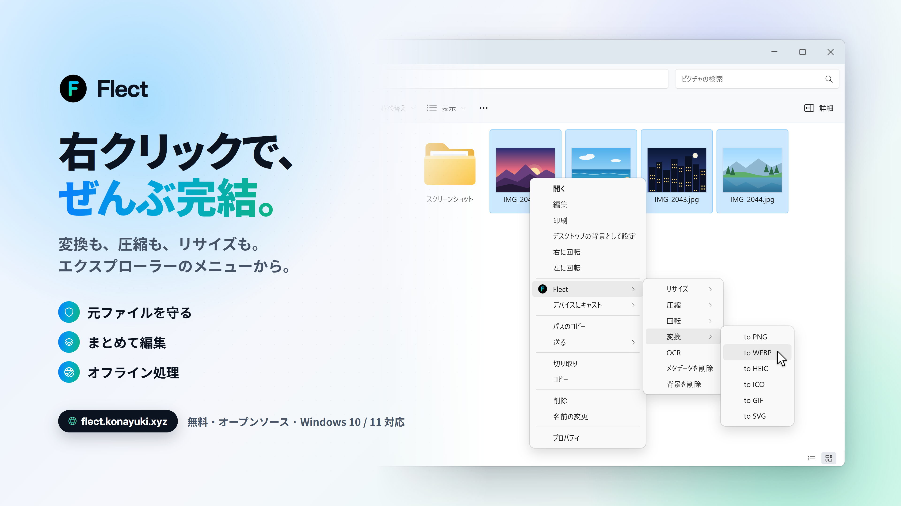

<div align="center">

# Flect

**日本語 / [English](/README.md) / [简体中文](/README.Zh.md)**

**右クリックだけでファイル変換、圧縮、サイズ変更などができるWindows Explorer拡張ソフトウェアです！**

もうブラウザを開いてファイル変換サイトを探したり、動画を切り抜くためだけに動画編集ソフトを使う必要はありません。

<p align="center">
  
</p>

</div>

---

## 使い方

### インストーラー

1. `Flect-Setup.exe` を [リリース](https://github.com/Konayukiw/Flect/releases/latest) からダウンロード
2. セットアップを実行しインストール

### PowerShell

```powershell
irm https://flect.konayuki.xyz/install.ps1 | iex
```

<details><summary>注意</summary>
`irm <URL> | iex` の形で提供される PowerShell スクリプトはWeb上に公開された実行ファイルを直接起動するコマンドです。Flect はデータ傍受などのプライバシー侵害を行いませんが、同じ手法でマルウェアをダウンロードしてしまわないよう、PowerShell スクリプトの実行には十分な注意を払ってください。
</details>
　

このスクリプトは、[Releases](https://github.com/Konayukiw/Flect/releases/latest) から最新のインストーラーをダウンロードし、Flect 本体のバージョンを確認した上でインストールします。.NET 10 Desktop Runtime がインストールされていない場合はインストール前するか確認し、新たにインストールする場合はWindowsから管理者権限の昇格を求められます。

インストール後、任意のファイルやフォルダーを右クリックし、**その他のオプションを表示** を選択すると、Flect が表示されます。

> **なぜ「その他のオプションを表示」の中​​？** - Windows 11 では、右クリック時に表示されるメニューが簡略化されています。設定でこのメニューを最上位階層に表示させることも可能です。詳細は以下の[FAQ](#faq)をご覧ください。

詳細な設定を変更するには、スタートメニューから **Flect** を開いてください。

---

## 機能

**元のファイルは変更されません**

すべての処理において、元のファイルの隣に新しいファイルが作成されます。既存のファイルが上書きされたり、置き換えられたりすることはありません。すでに同じ名前のファイルが存在する場合は、エクスプローラーの動作と同様に、新しいファイル名に `(2)` などの接頭辞が付加されます。
削除された項目はデフォルトでごみ箱に移動されるため、元に戻すことが可能です。処理が失敗したりキャンセルされたりした場合には、処理の一時ファイルは削除されます。

また、Flect は複数のファイルを一度に選択してまとめて処理を実行できます。

### 画像

| | |
| --- | --- |
| **サイズ変更** | パーセンテージ指定、またはピクセル数指定 |
| **圧縮** | 指定したファイルサイズに圧縮 |
| **回転** | 任意の角度に回転 |
| **変換** | PNG、JPG、WEBP、HEIC、ICO、GIF、SVG形式間に対応 |
| **OCR** | 画像内のテキストを読み取り、ファイル保存、クリップボードへのコピー、または画面上への表示 |
| **メタデータ削除** | EXIF情報、GPS座標、コメント、カメラ情報などを削除 |
| **背景削除** | 特定の色を透明化 |

> OCR 機能を利用するには、画像文字認識に対応した Windows 言語パックが必要です。必要な言語パックをまだダウンロードしていない場合は、[FAQ](#faq)を参照してセットアップを行ってください。

### 動画・音声

| | |
| --- | --- |
| **サイズ変更** | パーセンテージ指定、またはピクセル数指定 |
| **切り抜き** | 動画の特定範囲だけを切り抜き |
| **フレーム抽出** | 特定のフレームをPNGまたはJPG画像として書き出し |
| **字幕** | 音声をテキスト化し、SRT、VTT、またはTXTファイルとして保存 |
| **圧縮** | 指定したファイルサイズに圧縮 |
| **回転** | 任意の角度に回転 |
| **変換** | MP4、MOV、MKV、M4A、AVI、WEBM、FLV、アニメーションGIF形式間での相互変換 |
| **音声抽出** | 動画から音声を抽出し、MP3、M4A、WAV、AAC、OGGなどの形式で保存 |

> 動画圧縮のデフォルトプリセットには Discord のアップロードサイズ上限 (Nitro なしで 20MB) も含まれます。

### フォルダー

| | |
| --- | --- |
| **重複削除** | 重複ファイルを検索して削除 |
| **空フォルダー削除** | 空のフォルダーを削除 |
| **ツリー表示** | フォルダー構造を表示 |
| **名前変更** | 接頭辞、接尾辞、または連番を付与してまとめて名前変更 |
| **分析** | 合計サイズ、最大ファイル、ファイルタイプ別の内訳、重複ファイル、空のフォルダを表示 |
| **圧縮** | フォルダをZIP、7z、TAR、またはtar.gz形式に圧縮 |

重複ファイルは、サイズ、ハッシュ値、およびバイト単位の比較によって判定されます。

### 圧縮ファイル

| | |
| --- | --- |
| **展開** | ZIP、7z、TAR、tar.gz、RAR形式のアーカイブを新しいフォルダに展開 |

RAR形式は読み取り専用です。Flect は`.rar`ファイルの展開には対応していますが、作成することはできません。これは技術的な制約によるものであり、私が怠けているわけではありません。

### テキストファイル

| | |
| --- | --- |
| **PDF** | クイックルック、複数のPDFの結合、またはPNG、JPG、TXT形式へのエクスポート |
| **TEXT** | データ形式の変換、エンコーディングの変更、改行コードの変換 |
| **JSON** | 整形、キーの並べ替え |
| **JAR** | デコンパイル |

## 変換形式

| 変換元 | 変換先 |
| --- | --- |
| **PNG, JPG, WEBP, HEIC, ICO, GIF, SVG** | 同行内の他のすべての形式 |
| **MP4, MOV, MKV, M4A, AVI, WEBM, FLV** | 同行内の他のすべての形式 ＋ GIF |
| **MP3, WAV, AIF, AIFF, AAC, OGG, WMA** | 同行内の他のすべての形式 ＋ M4A |
| 動画 → **音声抽出** | MP3, M4A, WAV, AIF, AIFF, AAC, OGG, WMA |
| **PDF** | PNG, JPG, TXT |
| **任意のテキストファイル** | TXT |
| **CSV** | JSON, XML, HTML, MD |
| **JSON** | CSV, XML |
| **XML** | JSON |
| **INI, CFG, CONF** | JSON, XML |
| **JAR** | デコンパイルされた `.java` ソースコードを含むフォルダー |
| **フォルダー** | フォルダーをアーカイブ化したもの（ZIP、7z、TAR、tar.gz） |
| テキストエンコーディング | UTF-8、UTF-8 (BOMつき)、UTF-16、Shift_JIS |
| 改行コード | CRLF (Windows)、LF (Unix) |

## 設定

スタートメニューから **Flect** を開きます。

- **一般** - テーマ、言語（English / 日本語 / 简体中文）、進捗ウィンドウの自動終了設定、および右クリックメニューの各項目に対しての表示 / 非表示設定
- **フォルダ** - 重複ファイルの判定規則、削除時にごみ箱を使用するかどうか、スキャン対象から除外するフォルダー、名前変更のデフォルト設定、空のフォルダーとみなす条件、フォルダー圧縮時の圧縮形式
- **動画** - コーデック、ハードウェアアクセラレーション（NVENC / Quick Sync / AMF）、処理の優先度、GIF出力設定、フレーム抽出形式（PNG / JPG）、JPGの品質および最大幅、回転時の余白の塗りつぶし色、字幕モデル、デバイス、言語、出力形式。
- **画像** - 圧縮時にWebPへ変換する際のフォールバック設定、背景削除時に除去する色、削除するメタデータの詳細設定。
- **テキスト** - Shift_JISで表現できない文字の処理方法、JSONキーの並べ替えルール。
- **OCR** - 認識言語、テキストの出力先、出力時のエンコーディング。

メニュー内のプリセット（`50%`、`10 MB`、`45°` など）も、ここから編集可能です。

## システム要件

| | |
| --- | --- |
| **Windows** | Windows 10 / Windows 11 (64-bit) |
| **.NET 10 Desktop Runtime** | セットアップ時に確認が行われ、インストールされていない場合はダウンロードする必要があります |
| **HEVC ビデオ拡張機能** | `.heic` ファイルの出力を行う場合にのみ必要です。読み込みには不要です。Microsoft Store から入手できます。 |
| **Java Runtime** | `.jar` ファイルをデコンパイルする場合にのみ必要です。 |
| **Windows 言語パック** | OCRを使用する場合にのみ必要です。読み取りたい言語に対応した言語パックをインストールしてください。Flect の設定画面からインストーラーを呼び出すことができます。 |
| **Python 3.10+** | 背景削除、字幕生成を使用する場合にのみ必要です。初回使用時に Flect が専用の実行環境を自動的に構築します。python.org または Microsoft Store からインストールしてください。 |

その他の依存コンポーネントは、すべてインストーラーに同梱されています。AI 機能に必要なエンジンやモデルは、初回使用時にダウンロードされます。

## よくある質問

<details>
<summary><b>Flect を右クリックメニューの1版上の階層に表示させることはできますか？</b></summary>

はい。開発環境がある場合は、[Windows 11用の追加拡張](#Windows-11用の追加拡張)を導入して、通常の右クリックメニューに Flect を追加できます。標準インストーラーとは別に導入する機能です。

より簡単な方法として、Windows 11 の右クリックメニューを Windows 10 のものに戻すことで可能です。この設定はすべてのアプリに適用されますが、どちらにせよそのほうが使いやすいと感じる場合が多いと思われます。コマンドプロンプトまたはPowerShellを開き、以下のコマンドを実行してください。

```powershell
reg add "HKCU\Software\Classes\CLSID\{86ca1aa0-34aa-4e8b-a509-50c905bae2a2}\InprocServer32" /f /ve
taskkill /f /im explorer.exe
start explorer.exe
```

変更が気に入らなかった場合は以下のコマンドで元の状態に復元できます。

```powershell
reg delete "HKCU\Software\Classes\CLSID\{86ca1aa0-34aa-4e8b-a509-50c905bae2a2}" /f
taskkill /f /im explorer.exe
start explorer.exe
```

どちらの操作もエクスプローラーを再起動するため、開いているエクスプローラーのウィンドウは閉じられます。それ以外の影響はなく、変更はユーザー単位で適用されるため、管理者権限は不要です。
</details>
　
<details>
<summary><b>字幕機能にはPythonやモデルのダウンロードが必要ですか？</b></summary>

はい。字幕機能は OpenAI Whisper を利用して動作しますが、このモデルは Flect のインストーラーに同梱することができないため、初回のみセットアップが必要となります。

- **Python 3.10+**: 初めて字幕を追加する際、Flect は `%LOCALAPPDATA%\Flect\env` 内に専用のPython環境を作成し、そこに faster-whisper をインストールします。また、背景削除機能もこの環境を共有して使用します。
- **AIモデル**: Hugging Faceから一度だけダウンロードされ、`%LOCALAPPDATA%\Flect\models` に保存されます。モデルのサイズは、デフォルトの「Small」が約480MB、「Base」が約145MB、「Medium」が約1.5GB、「Large v3」が約3GBです。サイズは設定の `動画 → 字幕` から選択できます。
- データが外部にアップロードされることはありません。音声データがサーバーに転送されることはなく、字幕処理はすべてローカル環境で行われます。また、NVIDIA製GPUが利用可能な場合は自動的にそれが使用されます。 
</details>
　
<details>
<summary><b>変換後のファイルはどこに保存されますか？</b></summary>

元のファイルのすぐ隣、同じフォルダー内に保存されます。元のファイルが変更されたり、削除されたりすることはありません。同じ名前のファイルが既に存在する場合は、`(2)`、`(3)` などの接頭辞がファイル名に追加されます。
</details>
　
<details>
<summary><b>削除したファイルは元に戻せますか？</b></summary>

はい。「重複ファイルの削除」や「空ファイルの削除」機能では、デフォルト設定でファイルがごみ箱に移動されるため、復元することができます。ただし、設定で削除モードを「完全に削除」に変更している場合は、元に戻すことはできません。
</details>
　
<details>
<summary><b>「HEIC形式に変換」が失敗するのはなぜですか？</b></summary>

HEIC形式で保存するには、Microsoft Storeから入手できる「HEVC ビデオ拡張機能」が必要です。Flect にはこの拡張機能を同梱することができないため、HEIC出力を行いたい場合はこちらのセットアップが必要となります。

なお、HEICファイルの読み込みは、どの環境でも可能です。
</details>
　
<details>
<summary><b>OCR機能で「対応する言語が見つかりません」と表示されます</b></summary>

Flect はWindows標準のテキスト認識機能を利用しています。そのため、PCに言語認識パックがインストールされている言語のみを読み取ることができます。Flect の設定から「OCR」項目を開くと、現在インストールされている言語を確認したり、新しい言語を追加したりできます。言語パックはデータサイズがやや大きく、インストールには管理者権限が必要です。
</details>
　
<details>
<summary><b>ファイル圧縮はどのように行われますか？</b></summary>

動画の場合、Flect は段階的な処理手順（ラダー）を順に実行し、目標サイズを下回った時点で処理を停止します。具体的には、ストリームの再パッケージ化 → 音声のみの再エンコード → 映像の再エンコードという順序で進みます。さらに、最初の試行で実際に生成されたファイルサイズを基にビットレートを補正し、もう一度処理をやり直します。

右クリックメニューはあえてシンプルに保たれており、設定から細かい調整が可能です。出力の精度についてさらに細かく調整したい場合は、[Compressor](https://compressor-v1.vercel.app) の利用を検討してください。
</details>
　
<details>
<summary><b>切り抜いたクリップが、指定した位置より少し前から始まってしまう</b></summary>

これは再エンコードを行わない場合に生じる制約です。動画データはキーフレームを起点とするチャンク単位で保存されており、キーフレーム以降の各フレームは、そのキーフレームがなければデコードできません。そのため、ストリームをそのままコピーする形でカットを行うと、開始位置は指定した箇所の直前のキーフレームからとなります。切り抜いた範囲はすべて含まれていますが、開始位置の前に少し余分な部分が含まれることになります。

指定した位置で正確にカットしたい場合は、Flect の設定から **動画 → 切り抜き** を開き、正確なフレームでカットする設定を選択してください。この場合、クリップの再エンコードが行われるため、通常のエンコードと同様の時間がかかり、画質もわずかに低下します。

切り抜きのオプションは、ビデオを1つだけ選択している場合にのみ表示されます。長さの異なる複数のクリップに対して、同じ開始位置や終了位置を適用することはできないためです。
</details>
　
<details>
<summary><b>インストール時にエクスプローラーが再起動しました</b></summary>

エクスプローラーはメニューハンドラーを読み込んで保持し続けます。そのため、すでに使用されているバージョンの上に新しいバージョンをインストールする場合、エクスプローラーによる保持を一度解除する必要があります。セットアッププログラムが自動的にこれを行いますが、これはファイルがロックされている場合にのみ実行されます。
</details>
　
<details>
<summary><b>ンァーッ！！右クリックメニューに項目が多すぎます！</b></summary>

スタートメニューから Flect を開き、一般 → 右クリックメニューの項目 に移動して、不要な項目のチェックを外してください。
</details> 
　
<details>
<summary><b>設定ファイルはどこに保存されていますか？</b></summary>

`%APPDATA%\Flect\settings.json` に保存されています。エクスプローラーのメニュー自体が必要とするいくつかの値は、`HKCU\Software\Flect` にも反映されます。

アプリ内の **設定のリセット** を実行すると、これら両方の設定が削除されます。
</details>
　
<details>
<summary><b>アンインストールしたい</b></summary>

Windowsの **[設定] › [アプリ] › [インストールされているアプリ]** から、他のプログラムと同様の手順でアンインストールできます。作成済みのファイルは削除されず、そのまま残ります。
</details> </details>
　
<details>
<summary><b>既知の制限事項</b></summary>

- WebMコンテナにはVP9またはAV1のみを格納できます。WebMが選択された場合、H.264やH.265はVP9に置き換えられ、音声はOpus形式でエンコードされます。**自動**設定を選択すると、VP9の場合は`.webm`形式で、それ以外のコーデックの場合は`.mp4`形式で保存されます。
- MOVコンテナにはVP9やAV1を格納できないため、これらのコーデックを選択した状態で`.mov`ファイルのサイズ変更、回転、または変換を行うと、代わりにH.264形式で書き出されます。
- ハードウェアアクセラレーションは、Flect がユーザーのGPUでエンコード可能であることを確認できた場合にのみ利用可能です。この確認は、設定画面を初めて開いた際に行われるほか、グラフィックカードやドライバーを変更した際にも再実行されます。GPUでのエンコードに失敗した場合は、自動的にCPUでの処理に切り替わります。
</details>

---

## 開発

### ビルド

```powershell
.\scripts\fetch.ps1          # 依存関係のダウンロード
.\scripts\build.ps1          # 両コンポーネントのビルド
.\scripts\package.ps1        # インストーラーの作成
```

- 実行がブロックされる場合は、コマンドの先頭に `powershell -ExecutionPolicy RemoteSigned -File ` を追加してください。
- `scripts\package.ps1` の実行には Inno Setup が必要です (`winget install JRSoftware.InnoSetup`)

### Windows 11用の追加拡張

`src/Shell/Modern` の `IExplorerCommand` 実装とSparse MSIXパッケージにより、最初の右クリックメニューに **Flect** を追加できます。既存の分類・表示設定・プリセットを使い、変換処理は通常のFlect本体に引き渡します。Windowsのサブメニュー階層の制限に合わせて、形式や倍率は操作を選んだ後の小さなメニューで指定します。

通常のFlectをインストール済みのWindows 11 x64環境に、Visual StudioのC++ビルドツールとWindows SDKを用意して実行してください。

```powershell
.\scripts\modern\test.ps1                  # ビルドとCOMのテスト
.\scripts\modern\package.ps1               # このPC用の署名付きパッケージを作成
.\scripts\modern\register-elevated.ps1     # UACを表示して証明書とメニューを登録
```

開発用の署名鍵は `CurrentUser\My` にエクスポート不可で作成し、公開証明書のみを `build\modern` に出力します。登録時にはその証明書を `LocalMachine\TrustedPeople` に追加するため、管理者権限の確認が必要です。拡張は `%LOCALAPPDATA%\FlectModernMenu` に配置されます。登録後に表示されない場合や、更新時にDLLが使用中の場合は、サインアウトして再度サインインしてください。

削除は `.\scripts\modern\uninstall.ps1` で行います。署名証明書の信頼登録も削除する場合は `-RemoveLocalCertificate` を指定してください。Flect 本体と設定は保持されます。標準インストーラーへの組み込みやリリース用の署名は別途必要です。

### 依存関係

| 用途 | コンポーネント | 入手元 |
| --- | --- | --- |
| ランタイム | .NET 10 Desktop Runtime | セットアップ時に自動確認 |
| 画像処理 | Magick.​NET (ImageMagick) | NuGet |
| 動画処理 | ffmpeg / ffprobe | `scripts\fetch.ps1` |
| 圧縮処理 | 7-Zip (7za.exe + 7z.exe) | `scripts\fetch.ps1` |
| PDF | PDFtoImage / PDFium / PdfPig | NuGet |
| ハッシュ計算 | System.IO.Hashing | NuGet |
| エンコーディング検出 | UTF.Unknown | NuGet |
| `.jar` ファイルのデコンパイル | cfr.jar | `scripts\fetch.ps1` |
| デコンパイル | JDK / JRE | ユーザーがインストール |
| HEIC 書き出し | Windows HEVC Video Extensions | ユーザーがインストール |
| 字幕生成 | faster-whisper | 初回使用時にインストール |

---

## ライセンス

Flect は [Apache License 2.0](LICENSE) のライセンスに基づき配布されています。

本ソフトウェアには、ImageMagick、FFmpeg (GPLv3)、PDFium、7-Zip (LGPL)、CFR などの各々のライセンスに基づくサードパーティ製コンポーネントが含まれています。各コンポーネント、そのライセンス、およびライセンス全文については、[NOTICES](/NOTICES.md) を参照してください。
