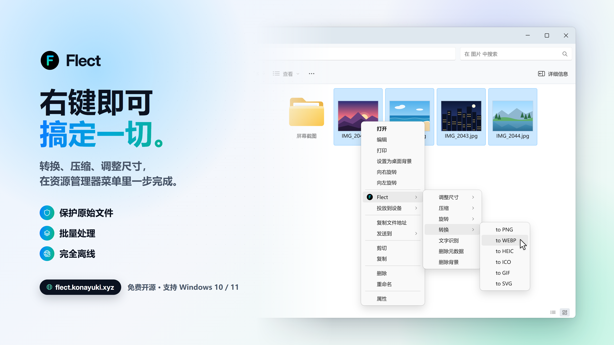

<div align="center">

# Flect

**[日本語](/README.Ja.md) / [English](/README.md) / 简体中文**

**在 Windows 资源管理器中右键点击任意文件或文件夹，即可完成格式转换、压缩、调整尺寸等操作！**

再也不用为了转换一个文件到处找在线工具，也不用为了压缩视频专门打开视频编辑软件。

<p align="center">
  
</p>

</div>

---

## 安装

### 安装程序

1. 从 [Releases](https://github.com/Konayukiw/Flect/releases/latest) 下载最新的 `Flect-Setup.exe`。
2. 运行安装程序，按提示完成安装。

### PowerShell

```powershell
irm https://flect.konayuki.xyz/install.ps1 | iex
```

<details><summary>警告</summary>
以 `irm <URL> | iex` 格式提供的 PowerShell 脚本，其作用是直接执行托管在网络上的文件。尽管 Flect 不会进行数据拦截等侵犯隐私的行为，但在执行任何 PowerShell 脚本时，仍请务必确保脚本本身确实安全；因为这种方式同样可能被用于下载恶意软件。
</details>
　

该脚本会从 [Releases](https://github.com/Konayukiw/Flect/releases/latest) 下载最新的安装程序，与 GitHub 公布的 SHA256 比对无误后再安装 Flect。如果电脑上没有 .NET 10 Desktop Runtime，脚本会先征得你的同意再安装，届时 Windows 会请求管理员权限。

安装完成后，右键点击任意文件或文件夹，选择 **显示更多选项** 就能看到 Flect。

> **为什么在“显示更多选项”里？** - Windows 11 默认使用精简版右键菜单。你也可以让 Flect 直接出现在第一层菜单中，方法见下方的 [常见问题](#常见问题)。

如需更改详细设置，请从开始菜单打开 **Flect**。

---

## 功能

**原始文件绝不会被改动。**

每项操作都会在原文件旁边生成一个新文件，不会覆盖或替换任何内容。如果文件名已被占用，新文件会像资源管理器那样自动加上 `(2)` 后缀。

删除的文件默认移到回收站，随时可以恢复。任务失败或被取消时，已经写入的内容会被自动清理。

想选多少文件都可以，Flect 会对整个选区一次性处理，而不是一个一个来。

### 图片

| | |
| --- | --- |
| **调整尺寸** | 按百分比缩小，或指定像素尺寸 |
| **压缩** | 压缩到指定的文件大小 |
| **旋转** | 支持任意角度，四角保持透明，格式不支持透明时填充为白色 |
| **转换** | 在 PNG、JPG、WEBP、HEIC、ICO、GIF、SVG 之间互相转换 |
| **文字识别** | 识别图片中的文字，可保存为文件、复制到剪贴板，或只在屏幕上显示 |
| **删除元数据** | 清除 EXIF、GPS 坐标、注释和相机信息 |
| **删除背景** | 将指定的颜色变为透明 |

> OCR需要安装支持 OCR 的 Windows 语言包。如果还没有安装所需的语言，请参阅 [常见问题](#常见问题) 中的语言包设置方法。

### 视频与音频

| | |
| --- | --- |
| **调整尺寸** | 按百分比缩小，或指定像素尺寸 |
| **剪切** | 拖到想要的片段，只保留这一段，无需重新编码，瞬间完成 |
| **缩略图** | 将任意一帧导出为 PNG 或 JPG 图片 |
| **字幕** | 将语音转写为 SRT、VTT 或 TXT 文件 |
| **压缩** | 压缩到目标大小，还内置一键 Discord 预设 |
| **旋转** | 支持任意角度，可自选填充颜色 |
| **转换** | 在 MP4、MOV、MKV、M4A、AVI、WEBM、FLV 之间互相转换，也可转为 GIF 动图 |
| **提取音频** | 将音轨提取为 MP3、M4A、WAV、AAC、OGG 等格式 |

### 文件夹

| | |
| --- | --- |
| **删除重复文件** | 找出内容完全相同的文件并删除 |
| **删除空文件夹** | 清理空文件夹 |
| **目录树** | 输出文件夹结构 |
| **批量重命名** | 按自定义的前缀、后缀或编号批量重命名 |
| **分析** | 显示总大小、最大的文件、各类型文件的占比、重复文件和空文件夹 |
| **压缩** | 将文件夹打包为 ZIP、7z、TAR 或 tar.gz |

重复文件通过文件大小、哈希值和逐字节比对来判定。

### 压缩包

| | |
| --- | --- |
| **解压** | 将 ZIP、7z、TAR、tar.gz 和 RAR 压缩包解压到新文件夹 |

RAR 只能解压：Flect 可以解压 `.rar` 文件，但无法创建。这是技术上的限制，绝不是作者偷懒。

### 文本文件

| | |
| --- | --- |
| **PDF** | 预览、将多个 PDF 合并为一个，或导出为 PNG、JPG、TXT |
| **文本** | 转换数据格式、更改字符编码或切换换行符 |
| **JSON** | 格式化，并可按规则对键排序 |
| **JAR** | 反编译为可直接阅读的 Java 源代码文件夹 |

## 转换格式

| 源格式 | 目标格式 |
| --- | --- |
| **PNG, JPG, WEBP, HEIC, ICO, GIF, SVG** | 同一行中的其他任意格式 |
| **MP4, MOV, MKV, M4A, AVI, WEBM, FLV** | 同一行中的其他任意格式 + GIF |
| **MP3, WAV, AIF, AIFF, AAC, OGG, WMA** | 同一行中的其他任意格式 + M4A |
| 视频 → **提取音频** | MP3, M4A, WAV, AIF, AIFF, AAC, OGG, WMA |
| **PDF** | PNG, JPG, TXT |
| **任意文本文件** | TXT |
| **CSV** | JSON, XML, HTML, MD |
| **JSON** | CSV, XML |
| **XML** | JSON |
| **INI, CFG, CONF** | JSON, XML |
| **JAR** | 包含反编译后 `.java` 源文件的文件夹 |
| **文件夹** | 该文件夹的 ZIP、7z、TAR、tar.gz 压缩包 |
| 文本编码 | UTF-8、UTF-8 (BOM)、UTF-16、Shift_JIS |
| 换行符 | CRLF (Windows)、LF (Unix) |

## 设置

从开始菜单打开 **Flect**。

- **常规** - 主题、语言（English / 日本語 / 简体中文）、进度窗口何时自动关闭，以及每个右键菜单项的开关，用不到的项目可以直接隐藏。
- **文件夹** - 重复文件的判定规则、删除时是否移到回收站、扫描时跳过的文件夹、批量重命名的默认设置、什么样的文件夹算作“空文件夹”，以及文件夹压缩使用的格式（ZIP / 7z / TAR / tar.gz）。
- **视频** - 编解码器、GPU 加速（NVENC / Quick Sync / AMF）、速度优先还是画质优先、GIF 导出设置、缩略图格式（PNG / JPG）、JPG 质量和最大宽度、旋转时的填充颜色，以及字幕使用的模型、设备、语言和输出格式。
- **图片** - 压缩时是否改用 WebP、删除背景时去除的颜色，以及具体清除哪些元数据。
- **文本** - Shift_JIS 无法表示的字符如何处理，以及 JSON 键排序规则。
- **文字识别** - 识别语言、文字输出到哪里，以及输出编码。

右键菜单中的预设值（例如 `50%`、`10 MB`、`45°`）也可以在这里修改。

## 系统要求

| | |
| --- | --- |
| **Windows** | Windows 10 / Windows 11 (64-bit) |
| **.NET 10 Desktop Runtime** | 安装程序会自动检测，缺少时会提示下载。 |
| **HEVC 视频扩展** | 仅在*写入* `.heic` 文件时需要，读取 HEIC 不需要。可从 Microsoft Store 获取。 |
| **Java（JDK 或 JRE）** | 仅在反编译 `.jar` 文件时需要。 |
| **Windows 语言包** | 仅文字识别需要，而且只需安装要识别的语言。可以从 Flect 的设置中直接打开安装界面。 |
| **Python 3.10+** | 仅 AI 功能（删除背景、字幕）需要。首次使用时，Flect 会创建一个独立的运行环境。可从 python.org 或 Microsoft Store 安装。 |

其余的图片、视频、PDF 和反编译引擎都已包含在安装程序中。AI 功能会在首次使用时联网下载所需的引擎和模型。Flect 不会上传任何数据，所有处理都在你的电脑上完成。

## 常见问题

<details>
<summary><b>能让 Flect 直接显示在第一层右键菜单里吗？</b></summary>

另外，如果具备开发环境，可以安装 [Windows 11 右键菜单扩展](#更好的-Windows-11-右键菜单)，让 Flect 直接显示在第一层右键菜单中。该扩展需要单独安装，不包含在标准安装程序中。

可以，把 Windows 11 的右键菜单切换回经典样式即可。这项更改会影响所有应用，不过大多数人反而觉得经典菜单更好用。

打开终端或命令提示符，运行以下命令：

```powershell
reg add "HKCU\Software\Classes\CLSID\{86ca1aa0-34aa-4e8b-a509-50c905bae2a2}\InprocServer32" /f /ve
taskkill /f /im explorer.exe
start explorer.exe
```

想恢复 Windows 11 的菜单时，运行：

```powershell
reg delete "HKCU\Software\Classes\CLSID\{86ca1aa0-34aa-4e8b-a509-50c905bae2a2}" /f
taskkill /f /im explorer.exe
start explorer.exe
```

两组命令都会重启资源管理器，已打开的资源管理器窗口会被关闭。除此之外不会有任何影响。这项更改只对当前用户生效，不需要管理员权限。
</details>
　
<details>
<summary><b>字幕功能需要 Python，还要下载模型？</b></summary>

是的。字幕功能依赖 AI 模型（OpenAI 的 Whisper），而 Flect 无法把它打包进安装程序。以下两项都只需准备一次：

- **Python 3.10+**：首次添加字幕时，Flect 会在 `%LOCALAPPDATA%\Flect\env` 下创建独立的 Python 环境，并在其中安装 faster-whisper。AI 功能 **删除背景** 也共用这个环境。
- **模型** 只会从 Hugging Face 下载一次，保存在 `%LOCALAPPDATA%\Flect\models`。默认的 *Small* 模型约 480 MB，*Base* 约 145 MB，*Medium* 约 1.5 GB，*Large v3* 约 3 GB。模型大小可以在 **视频 → 字幕** 中选择。
- 不会上传任何内容。音频始终留在你的电脑上，转写完全在本地进行。如果有可用的 NVIDIA 显卡，会自动用它加速（CUDA 库会安装到同一个环境中）。
</details>
　
<details>
<summary><b>转换后的文件保存在哪里？</b></summary>

就在原文件旁边，同一个文件夹里。原文件永远不会被修改或删除。如果文件名已被占用，Flect 会自动加上 `(2)`、`(3)` 等后缀。
</details>
　
<details>
<summary><b>删除的文件还能恢复吗？</b></summary>

可以。删除重复文件和删除空文件夹默认会把文件移到回收站，可以从那里还原。但如果在设置中把删除方式改成了彻底删除，就无法恢复了。
</details>
　
<details>
<summary><b>为什么“to HEIC”失败了？</b></summary>

写入 HEIC 需要 Microsoft Store 中的 **HEVC 视频扩展**，而 Flect 无法随附它。

目前没有可以免费随软件分发的 HEIC *编码器*。HEVC 视频扩展里自带 Windows 的编码器，因此 Flect 会通过 WIC 调用它来完成 `to HEIC`，其他格式则交给 ImageMagick 处理。

读取 HEIC 在任何电脑上都没有问题。
</details>
　
<details>
<summary><b>文字识别提示找不到对应语言的识别器</b></summary>

Flect 使用 Windows 内置的文字识别功能，只能识别电脑上已安装识别组件的语言。打开 Flect 的设置 → **文字识别**，可以查看已安装的语言，也可以添加新语言。语言包体积稍大，安装时需要管理员权限。
</details>
　
<details>
<summary><b>压缩到目标大小是怎么做到的？</b></summary>

对于视频，Flect 会按顺序逐级尝试，一旦低于目标大小就停下：先重新封装音视频流，再只重新编码音频，然后重新编码画面。之后还会根据第一次实际得到的文件大小修正码率，再尝试一次。

右键菜单刻意保持简洁，更深入的选项都放在设置里：编解码器、GPU 加速，以及是否允许通过降低分辨率或帧率来换取更小的体积。如果需要更精细的控制，可以考虑使用 [Compressor](https://compressor-v1.vercel.app)。

视频压缩会先写入目标位置旁边的隐藏临时目录，所以不会出现只写了一半的文件，输出文件只会在全部完成后才出现。
</details>
　
<details>
<summary><b>剪切出的片段比我标记的位置早开始了一点</b></summary>

这是不重新编码的代价。视频是按以关键帧开头的数据块存储的，关键帧后面的画面离开它就无法解码。所以直接复制流的剪切只能从标记位置之前最近的关键帧开始，可能会提前几秒。你要的内容一帧不少，只是开头多了一小段，而且点击之后文件马上就能生成。

如果需要在标记处精确剪切，请打开 Flect 的设置 → **视频 → 剪切**，把“剪切位置”改为“精确到所选位置”。这样会重新编码片段，耗时和普通编码一样，画质也会略有下降。

只有在选中单个视频时才会显示剪切。同一组起止时间放在长度不同的多个视频上，并没有意义。
</details>
　
<details>
<summary><b>为什么安装时资源管理器重启了？</b></summary>

资源管理器会把菜单处理程序加载到自己的进程中，并一直占用着它。因此，在已经使用过的旧版本上覆盖安装时，需要先让资源管理器释放这个文件。安装程序会自动处理，而且只在文件确实被占用时才会这样做。
</details>
　
<details>
<summary><b>菜单里的项目太多了</b></summary>

从开始菜单打开 Flect，进入 **常规 → 右键菜单项**，取消勾选不需要的项目即可。取消勾选的项目会从资源管理器的菜单中完全消失。
</details>
　
<details>
<summary><b>设置保存在哪里？</b></summary>

保存在 `%APPDATA%\Flect\settings.json`。资源管理器菜单本身要用到的少量设置会同步到 `HKCU\Software\Flect`。

在应用中点击 **重置设置** 只会清除这两处内容，右键菜单的注册信息和已记录的编码器检测结果都会保留。
</details>
　
<details>
<summary><b>如何卸载？</b></summary>

和其他程序一样，在 Windows 的 **设置 › 应用 › 已安装的应用** 中卸载即可。已经生成的文件不会被删除。
</details>
　
<details>
<summary><b>已知限制</b></summary>

- WebM 只能封装 VP9 或 AV1。选择 WebM 作为封装格式时，H.264 和 H.265 会换成 VP9，音频则编码为 Opus。选择 **自动** 时，VP9 保存为 `.webm`，其他编解码器保存为 `.mp4`。
- MOV 无法封装 VP9 或 AV1，因此在选择这两种编解码器时，对 `.mov` 进行调整尺寸、旋转或转换，会改为输出 H.264。
- 只有在 Flect 确认你的显卡确实能够编码后，才会提供 GPU 加速。首次打开设置时会进行检测，更换显卡或驱动后也会重新检测。即便如此 GPU 编码仍然失败时，会自动改用 CPU 完成。
</details>

---

## 开发

### 构建

```powershell
.\scripts\fetch.ps1          # 下载依赖项
.\scripts\build.ps1          # 编译两个部分
.\scripts\package.ps1        # 打包安装程序
```

- 如果脚本被阻止运行，请在命令开头加上 `powershell -ExecutionPolicy RemoteSigned -File `。
- `scripts\package.ps1` 需要 Inno Setup（`winget install JRSoftware.InnoSetup`）。

Flect 由两部分组成：用 C++ 编写的 Shell 扩展（`src/Shell`）负责在资源管理器中显示菜单，用 .NET 编写的工作程序（`src/App`）负责实际处理和管理设置。菜单是经典的 `IContextMenu` 处理程序，这也是 Windows 11 把它放进“显示更多选项”的原因。

### 更好的 Windows 11 右键菜单

`src/Shell/Modern` 通过 `IExplorerCommand` 和稀疏 MSIX 包，把 **Flect** 直接添加到 Windows 11 的第一层右键菜单中。它复用现有的文件分类、菜单标签、隐藏项设置、预设和处理命令。经典菜单仍然可用。

Windows 只支持一层 `IExplorerCommand` 子命令。因此，现代版 Flect 子菜单会列出 **调整大小**、**转换** 等操作，选中后在小型原生弹出菜单中指定格式或倍率。不需要选择的操作会直接启动现有工作程序。文件检查会推迟到 Explorer 的同步 UI 路径之外，弹出菜单和工作程序分别在独立进程中运行。

要构建并试用这个可选扩展，请先安装普通版 Flect，并使用带有 Visual Studio C++ 生成工具和 Windows SDK 的 Windows 11 x64 环境：

```powershell
.\scripts\modern\test.ps1                 # 构建并测试 COM 接口契约
.\scripts\modern\package.ps1              # 在本机创建并签名稀疏包
.\scripts\modern\register-elevated.ps1    # 请求 UAC，信任本地签名证书并注册
```

本地打包脚本会在 `CurrentUser\My` 中创建不可导出的代码签名密钥，并且只把公开证书导出到被 Git 忽略的 `build\modern` 目录。注册时会把该证书添加到 `LocalMachine\TrustedPeople`，因此需要管理员批准。扩展的二进制文件位于 `%LOCALAPPDATA%\FlectModernMenu`，与现有 Flect 安装分开。注册后可能需要重新打开 Explorer，或注销后重新登录。如果更新时 DLL 仍在使用中，也需要注销后重试。

这是可选的开发用包，正常安装程序和发布签名流程不变。正式发布应使用项目的生产签名身份，而不是共用本地生成的开发证书。

```powershell
.\scripts\modern\test.ps1 -InvokeWorker -Packaged       # 同时测试已安装的 COM 激活和 JSON 格式化
.\scripts\modern\uninstall.ps1                          # 仅删除现代菜单
.\scripts\modern\uninstall.ps1 -RemoveLocalCertificate  # 同时删除其计算机信任项（UAC）
```

默认冒烟测试不需要已安装的工作程序或管理员权限，并且已包含在 CI 中。测试覆盖 Unicode 路径、多选、不支持与混合选择、文件夹、子命令枚举、COM 生命周期，以及在需要时测试已安装的包激活。卸载扩展会保留原有的 Flect 安装和设置。

### 依赖项

| 用途 | 组件 | 来源 |
| --- | --- | --- |
| 运行时 | .NET 10 Desktop Runtime | 安装程序自动检测 |
| 图片 | Magick.​NET (ImageMagick) | NuGet |
| 视频 | ffmpeg / ffprobe | `scripts\fetch.ps1` |
| 压缩包 | 7-Zip (7za.exe + 7z.exe) | `scripts\fetch.ps1` |
| PDF | PDFtoImage / PDFium / PdfPig | NuGet |
| 哈希计算 | System.IO.Hashing | NuGet |
| 编码检测 | UTF.Unknown | NuGet |
| 反编译 `.jar` | cfr.jar | `scripts\fetch.ps1` |
| 反编译所需环境 | JDK / JRE | 用户自行安装 |
| 写入 HEIC | Windows HEVC 视频扩展 | 用户自行安装 |
| 字幕 | faster-whisper | 首次使用时安装 |

---

## 许可证

Flect 采用 [Apache License 2.0](LICENSE) 授权。

Flect 随附的第三方组件遵循各自的许可证，包括 ImageMagick、FFmpeg (GPLv3)、PDFium、7-Zip (LGPL) 和 CFR。所有组件、对应的许可证及许可证全文，请参阅 [NOTICES](/NOTICES.md)。
